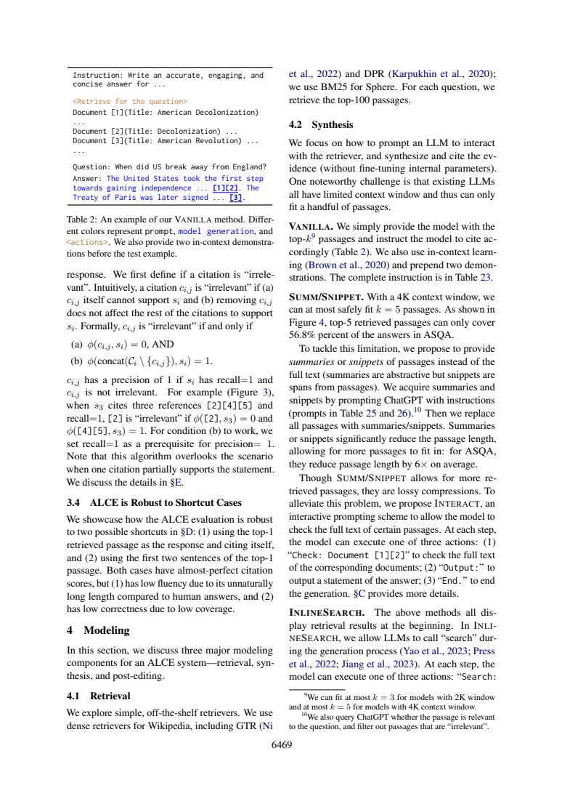

# 压缩检索段落后，为什么还需要回查原文

这份分享解决一个具体的论文阅读问题，采用“先冻结问题与验收标准→编号原文→真实AI回答→严格定位→语义核查”的流程。范围、任务和作者判断在下文明确分开；不是对原论文实验的复现，也没有宣称模型、提示词或工作流普遍更优。此前我在同项目阅读过这两篇论文；本次主题与既有query位置干预文章不同，实际调用也是新产生的。

## 压缩、省空间与保留证据是三个问题

ALCE §4.2物理页5（6469）将SUMM定义为abstractive summaries，SNIPPET为原文passage中的spans，两者用来替换完整检索段落。4K上下文设置最多安全容纳k=5完整段落；top-5只覆盖ASQA答案的56.8%，ASQA上摘要/片段平均把段落长度缩短约6倍。这里的56.8%是检索覆盖，不是生成答案准确率；6倍限定ASQA，既非所有数据集，也非整套系统延迟或费用的6倍。



脚注还说明2K窗口模型最多k=3、4K窗口最多k=5。摘要和片段虽然风格不同，都是lossy compression，不能保证完整保留每个论证条件。“full text”在这里是被检索passage的全文，不是下载整篇原始论文或网页。INTERACT允许在压缩材料外按需检查某些passage原文，以缓解信息丢失。

|动作/限制|依据与含义|
|---|---|
|Check: Document [1][2]|读取对应passages全文|
|Output:|输出一条答案statement|
|End.|结束生成|
|最多检查3篇|附录C物理页15：控制上下文预算|
|每次check后强制output|抑制连续检查过多|
|全文一次动作后移除|节约上下文，不保证后续步骤一直持有全文|

这些实现约束必须同时说明；仅写“Agent随时读全文直到满意”会把预算和状态生命周期弄错。它们是本文方法设置，不是所有RAG框架的通用协议，也不是已经证明最优的3篇预算。

## 新调用核查

原答D2/D3能列出三种动作、三篇上限、强制output与移除约束，D4也拒绝无损和必然更好。但D1把约6倍压缩写成一般段落性质，未清楚限定ASQA；更重要的是它的概念生命周期说check后“必须或可”Output/End，与附录实现的强制output冲突。后文D3纠正并不意味着前面的表可直接用于实现。

D4援引Table11捷径评估和部分引用局限来讨论INTERACT效果，属于相关背景，不是INTERACT与非交互方法的直接收益证据。正确结论应更窄：所供页解释设计动机与实现，未提供足以证明普遍优越的对照。不能把“这两页没给”写成“全文没有任何结果”。后续读方法可先给每个数值标任务与窗口条件，再画动作状态表；本版未追加调用验证改进。

## 真实记录与复做

本次一轮Bohrium CLI2.8.1原生调用，请求gpt-5-mini/photon，实际返回chenkun/gpt-5-mini。无历史无工具，180秒预算，实际墙钟（含预检及客户端开销）30.102秒，输入2878、输出3767 tokens。completion ID见metadata；精确snapshot/temperature/seed不可得。费用无逐次货币信息，cost=null，不能当0。正文判断由Codex辅助非盲核查，不伪装独立人类评审。

完整[实际输入](run-request.txt)、[预检](run-preflight.json)、[原始响应](run-response.json)、[模型原答](run-output.json)、[元数据](run-metadata.json)、[stderr](run-stderr.txt)均保留。response仅脱敏私人余额。没有重写原答，也没有失败后挑选新答案。本次严格JSON/行范围结果为`ranges_valid`，共15段；这只检查id覆盖、字段存在与行范围，不检测问题语义对应、单位、蕴含或原文是否充分。

本地复查（Python3标准库、无需联网）：

```sh
python validate.py sources.json run-output.json
```

预期状态以validation.json为准；ranges_valid退出0，range_errors/invalid_json退出1，这是保留原答的真实验证结果；请继续逐项比对[编号原文](numbered.txt)、正文审计与[调用前标准](criteria.md)。D1–D4标签存在不表示它们分别答对了问题。

独立重做需从玻尔官方渠道安装Bohrium CLI并手动登录，确保额度。保留这些文件同目录，用原生exe或对应系统原生二进制：

```sh
python replay.py --bohr /absolute/path/to/bohr --condition workflow --out new-run
```

replay先dry-run逐字验证实际message，再调用；现有out拒绝覆盖。Windows .cmd历史上会截断多行参数，原生exe避免这一已遇到的问题；命令行仍需低于Windows长度限制。若代理影响认证，本脚本仅移除子进程HTTP_PROXY/HTTPS_PROXY/ALL_PROXY及小写变量，不修改系统代理。真实输入含非语义UUID，新调用不保证逐字相同，按预先标准核验。失败记录不应删改，网络失败不得伪造成功。

## 文件导航与许可

[task.txt](task.txt)列出确切四项问题；[workflow.txt](workflow.txt)为本次方法；[protocol.md](protocol.md)为运行约束；[protocol-lock.json](protocol-lock.json)记录六个事前文件SHA256（对应本目录同名文件）。[sources.json](sources.json)保留原文页面、物理页和source_id，[SOURCES.md](SOURCES.md)说明作者、版本、页码、原PDF哈希与许可。图是原页核查材料，关键结论都另有文字，不依赖看图取数。

[validate.py](validate.py)是机械检查器；[replay.py](replay.py)保存全新请求与响应。只有本次输入输出进入本作品，未把旧实验重复包装。论文采用CC-BY4.0，原创文字与代码MIT。来源研究归论文作者；本次贡献是具体问题设计、适配编号流程、一次实际玻尔阅读、对原答缺陷的原文核查及可照做教程。
